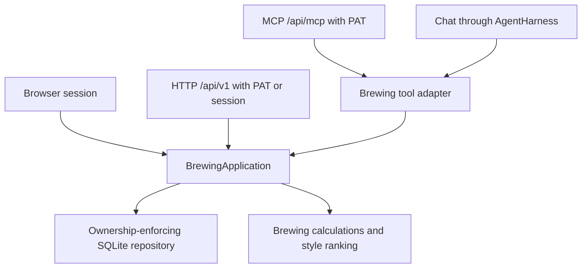

# Application architecture and HTTP API

The typed `BrewingApplication` in [`application-service.ts`](../frontend/src/lib/server/application-service.ts) is the authenticated brewing boundary. Browser routes, `/api/v1`, MCP and chat call this core with a verified principal. It applies capability checks and shared validation before using the SQLite repository and deterministic brewing calculations. New clients should reuse this boundary instead of duplicating domain rules or depending on the browser's state.

## Identity and authority

Local username/password login creates an opaque HttpOnly session. The first owner becomes an administrator atomically; later accounts are administrator managed. An existing installation receives stable usernames and a first administrator through schema v2 migration. Account roles never come from editable preferences. See [local accounts and operator recovery](local-accounts.md).

External clients use bearer PATs. The shared request boundary derives `AccessPrincipal` from the token or session; neither callers nor models supply the owning user or permissions. The core copies that authority when constructed. A session permits its account's brewing operations; a PAT carries only its selected capabilities.

| Capability | Operations |
| --- | --- |
| `recipes:read` | Own recipes, ingredients, steps, calculations and native exports |
| `recipes:write` | Recipe and relation mutations, clone and import; includes recipe reads |
| `catalog:read` | Reference catalogue reads and style matching |
| `profile:read` | Own brewing profile, unit preference and profile preferences |
| `profile:write` | Update own brewing profile; includes profile reads |

Style matching requires both `recipes:read` and `catalog:read`. Other capabilities are independent. PATs cannot manage accounts, roles, tokens or agent settings. Cross-user recipe access returns a missing-resource error. Token expiry, revocation and quota checks happen at the shared authentication boundary. Validated PAT responses expose `X-RateLimit-Limit`, `X-RateLimit-Remaining` and `X-RateLimit-Reset` in Unix seconds; exhausted quotas return 429 with `Retry-After`.

## Versioned HTTP/JSON contract

Use `/api/v1` for external HTTP clients. The locally served API reference at `/api/docs` and its `/api/docs/openapi.json` specification are the detailed source for request fields, catalogue filters and schemas. [`openapi.ts`](../frontend/src/lib/api/openapi.ts) and route tests must change together when the contract changes. Browser-only account/chat routes are separate session-authenticated interfaces.

Paths in this table are relative to `/api/v1`:

| Path | Methods | Result |
| --- | --- | --- |
| `/recipes` | GET, POST | Paged recipe search; create recipe |
| `/recipes/{id}` | GET, PATCH, DELETE | Full recipe; update; delete |
| `/recipes/{id}/calculations` | GET | Recipe with calculated brewing statistics |
| `/recipes/{id}/styles` | GET | Ranked styles; comma-separated `keywords`, `limit` defaults to 10 |
| `/recipes/{id}/clone` | POST | Clone with required `{ "name": "New name" }` |
| `/recipes/import` | POST | Import Brewey native JSON atomically |
| `/recipes/{id}/export` | GET | Raw Brewey native JSON attachment |
| `/catalog/{kind}` | GET | Paged reference catalogue search |
| `/catalog/{kind}/{id}` | GET | Reference catalogue record |
| `/recipes/{id}/ingredients/{kind}` | GET, POST | List or add recipe ingredient |
| `/recipes/{id}/ingredients/{kind}/{itemId}` | GET, PATCH, DELETE | Read, update or remove ingredient |
| `/recipes/{id}/steps/{kind}` | GET, POST | List or add process step |
| `/recipes/{id}/steps/{kind}/{itemId}` | GET, PATCH, DELETE | Read, update or remove step |
| `/profile` | GET, PATCH | Own brewing profile |

Catalogue kinds are `grain`, `hop`, `yeast`, `misc` and `style`. Ingredient kinds are `grain`, `hop`, `yeast`, `misc` and `water`; process kinds are `mash` and `fermentation`. Catalogue records are reference data; this API does not mutate the shared catalogue.

Success responses use `{ "data": ... }`. Paged recipe/catalogue results contain an array in `data` and `{ "total", "limit", "offset" }` in `meta`. List pagination defaults to 50 items and offset 0; limits are 1–500 and offsets 0–1,000,000. Recipe filters include text, ingredient and numeric brewing ranges; catalogue filters are kind specific. Unknown or repeated query parameters are rejected. Deletes return `{ "data": null }`. Native export is the exception to the envelope: the response itself is a `brewey-native` version `1.0.0` document, downloaded as `recipe.brewey`.

JSON mutations require `Content-Type: application/json` and an object body, bounded to 2 MiB. Unknown write fields, client-supplied ownership, invalid units, incompatible addition timing and invalid references are rejected. Errors use `{ "error": "message" }`, with 400 for invalid arguments, 401 for missing/invalid authentication, 403 for insufficient capabilities, 404 for absent or inaccessible resources, 413 for oversized bodies, 415 for unsupported media types and 429 for exhausted quotas.

HTTP physical quantities always use explicit metric fields such as `amount_kg`, `amount_grams`, `volume_liters`, `temperature_c`, `time_minutes` and ion concentrations in ppm. Setting an imperial profile does not change this HTTP contract. The MCP tool adapter converts its arguments/results to the selected unit system; SQLite and canonical chat recipe-pane results remain metric. Native export also uses metric fields and includes ingredient names/style numbers for portable reference matching.

The complete bundled catalogue is canonical reference data validated by [`check-catalog.py`](../scripts/check-catalog.py), with stable identities and an explicit content/provenance manifest. It does not import personal libraries. See [NOTICE](../NOTICE.md) for redistribution status.

## Agents and future clients

[`AgentHarness`](../frontend/src/lib/harness/README.md) separates subscription/model protocol from brewing operations. The registry explicitly declares installed adapters, their supported connection/settings features, storage namespaces and factories. Codex is the first production adapter. Unknown selections fail explicitly. Account preferences store `agentAdapter` and `agentPreferences[adapterId]`; brewing profile preferences are a separate resource. `.env` supplies deployment configuration, not a shared model or effort selection.

The session-authenticated `/api/agent` routes manage adapter selection, preferences, connection, live models and cancellation. Chat binds a request-scoped brewing executor to the authenticated principal. Each adapter gets its own application-owned user home; no desktop Codex credentials, API-key fallback or paid provider is inherited. Brewey offers ChatGPT device-code connection; browser callbacks are not exposed by the current hosted UI.

A native OS launcher, verified OS identity adapter, TUI, mobile app and brewery automation are deferred. Account records reserve an identity boundary, but there is no current OS login or local-address authentication bypass. Future external clients can use `/api/v1` or MCP; future in-process clients should use the same typed core with independently verified identity.

## Verification and rollout

Core/storage fixtures use synthetic temporary SQLite databases. Versioned route tests exercise real authentication, PAT capabilities, cross-user denial, strict validation, transactions and native round trips; docs tests check the local API viewer and OpenAPI contract. [`smoke-api-v1.mjs`](../scripts/smoke-api-v1.mjs) accepts three explicitly supplied disposable-account PATs (all capabilities, same-owner recipe read only, other-owner all capabilities) and cleans up only recipes it creates. Its environment inputs are `BREWEY_API_ORIGIN`, `BREWEY_API_TOKEN`, `BREWEY_API_READ_TOKEN` and `BREWEY_API_OTHER_TOKEN`. Keep token values out of command arguments, logs and Git.

Run the documented test/type/lint/build commands before rollout. See [deployment](deployment.md) for installation and [local recovery](local-accounts.md) before changing account credentials. The production installation check uses temporary synthetic accounts and exercises setup, restart, backup and first-run restore without connecting an agent.

Saved conversations live in the session-authenticated conversation core, with one active chat per account independent of recipe selection. Per-turn recipe activity supports history search across multiple recipes; it does not change chat identity or create recipe memory summaries. SQLite is the portable transcript; native thread bindings, compaction and deletion are optional harness capabilities. Chat never accepts client history or ownership. Working context and the readable transcript have separate lifecycles; [conversations.md](conversations.md) records the behavior, interruption guards and backup rules.
